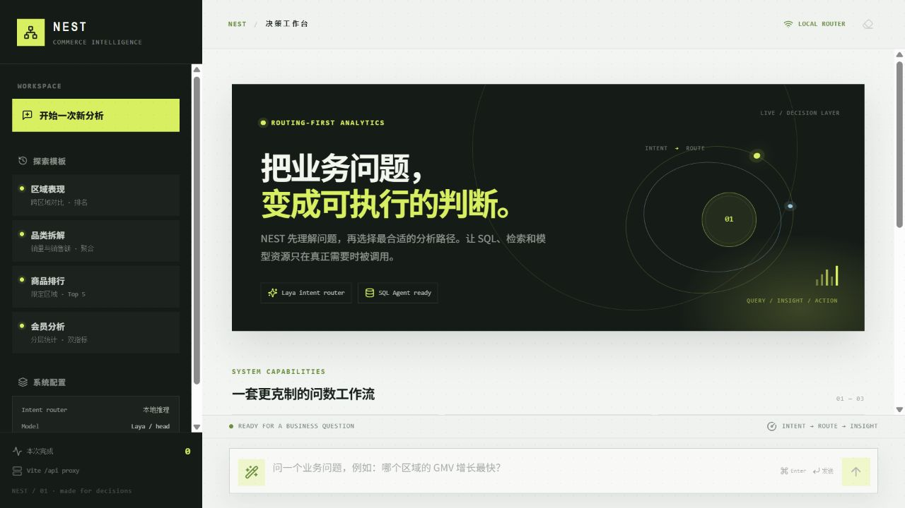
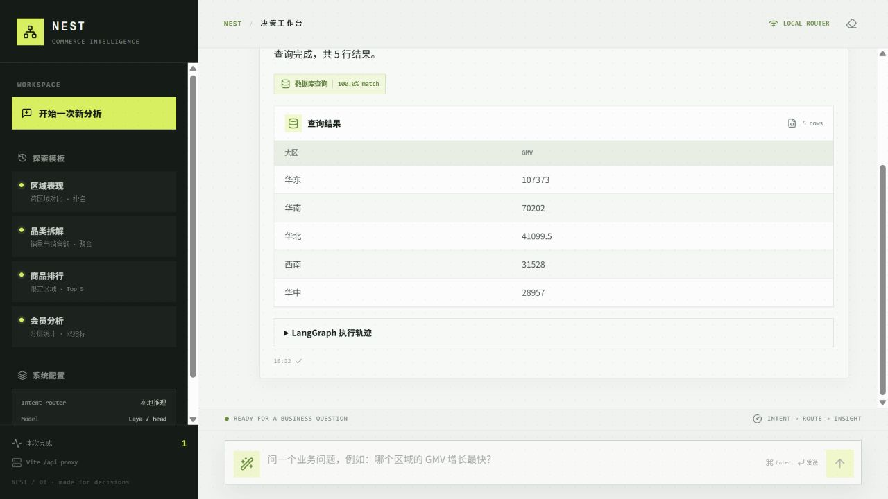
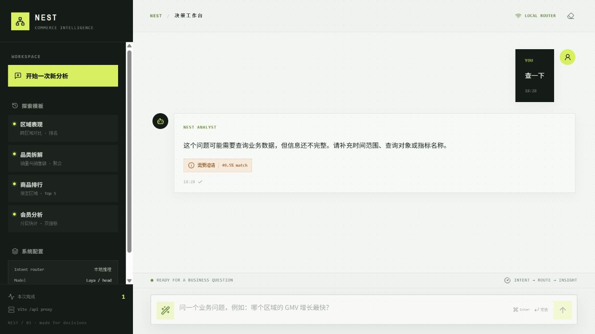
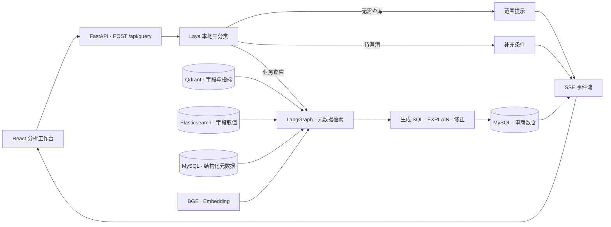

<div align="center">

# NEST · Commerce Intelligence

**电商数据分析工作台**

用自然语言查询销售额、订单和客群指标。查询前先完成本地意图分类，再按需启动检索和 SQL 工作流。


[](LICENSE)

[界面展示](#界面展示) · [系统架构](#系统架构) · [模型评估](#模型评估) · [本地运行](#本地运行) · [接口](#接口)

</div>

## 界面展示



| 区域 GMV 查询 | 条件不足时的澄清提示 |
| :--- | :--- |
| [](docs/screenshots/query-result.jpg) | [](docs/screenshots/clarification.jpg) |
| FastAPI 流式返回 MySQL 查询的 5 行结果，表格下方可展开 LangGraph 执行轨迹。 | 「查一下」被识别为待澄清，界面提示补充时间、对象或指标。 |

截图取自本地运行的 React 前端和 FastAPI 后端。订单金额来自仓库自带的演示数仓。

## 功能

- **业务查询** · 支持按时间、地区、品类、商品和会员等级筛选、分组和排名。
- **意图分流** · 本地 Laya 模型区分查库、无需查库和待澄清请求。后两类返回提示，结束当前请求。
- **元数据召回** · Qdrant 召回字段和指标，Elasticsearch 检索字段取值。候选结果经合并与筛选后进入 SQL 生成上下文。
- **SQL 执行** · LangGraph 生成候选 SQL，经 MySQL `EXPLAIN` 校验。校验失败时执行一次修正，再对修正结果进行校验。新建演示数仓为应用账号配置 `SELECT` 权限。
- **过程可见** · FastAPI 按 SSE 推送路由、节点状态和结果。React 展示表格与可展开的执行轨迹，可中止浏览器端的流式请求。

## 系统架构



构建命令读取 `conf/meta_config.yaml` 中的表、字段、别名及指标定义，并从样例数仓补齐字段类型和可检索取值。结构化元数据、向量和取值索引分别写入 MySQL、Qdrant 和 Elasticsearch。查询请求使用已构建的索引。

## 模型评估

训练冻结 Laya 编码器，仅更新决策头。在开发集上拟合温度参数，并使用固定的 203 条电商路由测试样本做对照。默认检查点是训练起点，multilingual 是独立参照。

| 测试集指标 | Laya 默认检查点 | Laya multilingual | NEST 路由模型 |
| :--- | ---: | ---: | ---: |
| Accuracy | 50.74% | 58.13% | **94.09%** |
| Macro-F1 | 25.67% | 39.64% | **93.63%** |
| 查库类召回率 | 100.00% | 100.00% | 96.00% |
| 澄清类召回率 | 0.00% | 0.00% | **97.92%** |
| 平均 Brier score，越低越好 | 0.2131 | 0.2501 | **0.0299** |

测试数据以项目合成样本为主。指标用于比较此测试集上的路由表现，其中查库类有 4 条漏判。训练、评估命令和模型路径见 [模型训练与评估](laya_finetune/README.md)。

## 仓库结构

```text
app/
├── api/             API 路由、请求模型和生命周期
├── services/        意图分类、查询分流和元数据建库
├── agent/           LangGraph 定义、执行状态和节点
├── repositories/    MySQL、Qdrant 和 Elasticsearch 数据访问
├── clients/         连接池与服务客户端
└── scripts/         元数据构建及意图样本工具
conf/               运行配置模板和业务元数据
data/               可版本化的合成意图样本
docker/             Compose、数据库定义及样例数仓
docs/screenshots/   本地运行截图
frontend/           React、TypeScript、Vite
laya_finetune/      训练、校准和离线评估
prompts/            检索和 SQL 工作流提示词
main.py             FastAPI 应用入口
```

## 本地运行

需要 Python 3.14、uv、Node.js 22、pnpm 10 和 Docker Compose。完整查库流程还需要能调用的 OpenAI 兼容模型接口，以及本地 Laya 路由检查点。首次会下载 Python 依赖、基础设施镜像和模型。

### 1. 配置与启动基础设施

```powershell
git clone https://github.com/Wiser-Ming/nest-commerce-intelligence.git
cd nest-commerce-intelligence
Copy-Item .env.example .env
Copy-Item conf/app_config.example.yaml conf/app_config.yaml
```

在 `.env` 修改 MySQL 密码，并填写 `LLM_API_KEY`、`LLM_BASE_URL` 和 `LLM_MODEL`。本地配置使用 [YAML 模板](conf/app_config.example.yaml) 中的端口。应用的 `shopkeeper` 账号由 Compose 初始化。

```powershell
docker compose --env-file .env -f docker/docker-compose.yaml up -d --build
docker compose --env-file .env -f docker/docker-compose.yaml ps
curl.exe -f http://127.0.0.1:8081/health
```

| 服务 | 本机端口 | 功能 |
| :--- | :--- | :--- |
| MySQL | 3307 | `meta` 元数据和 `dw` 演示数仓 |
| Elasticsearch | 9200 | IK 中文分词和字段值检索 |
| Qdrant | 6333 | 字段、指标向量检索 |
| Text Embeddings Inference | 8081 | BGE中文 Embedding，1024 维 |
| Kibana 可选 | 5601 | 启用 Compose 的 `tools` profile 后可用 |

### 2. 准备索引与路由模型

在仓库根目录执行。已有兼容检查点时，将 `intent_router.model_path` 指向该目录并跳过训练。

```powershell
uv sync --locked
$env:HF_HOME = "$PWD/.model-cache"
uv run --locked python -m app.scripts.build_meta_knowledge --conf conf/meta_config.yaml
uv run --locked python -m laya_finetune.prepare_dataset
uv run --locked python -m laya_finetune.train_head --device auto
```

Compose 默认使用 CPU 版 Embedding，路由配置模板也默认使用 CPU。训练适配 CUDA PyTorch 后可选择 GPU。生成权重保存在 `laya_finetune/artifacts/shopkeeper-router-head/`。

### 3. 启动应用

后端与前端使用两个终端。下面第一条在项目根目录执行。

```powershell
uv run --locked uvicorn main:app --host 127.0.0.1 --port 8000
```

```powershell
cd frontend
pnpm install --frozen-lockfile
pnpm dev
```

打开 [工作台](http://127.0.0.1:5173) 或 [OpenAPI 文档](http://127.0.0.1:8000/docs)。可以输入：

| 请求 | 预期分支 |
| :--- | :--- |
| 统计 2025 年第一季度各大区的 GMV，并按 GMV 从高到低排序 | 数据库查询 |
| 查一下 | 请求澄清 |
| 什么是 GMV？ | 无需查库 |

## 接口

`POST /api/query` 接收 `{"query":"查一下"}`，返回 `text/event-stream`。每个事件通过 `data:` 携带带有 `type` 的 JSON。响应头 `X-Request-ID` 可用于关联请求。

| 事件 | 负载 |
| :--- | :--- |
| `progress` | `step`、`status` |
| `route` | `intent`、`confidence`、`probabilities`、`model` |
| `text` | `content`，用于澄清或范围提示 |
| `result` | `data`，查询返回的表格行 |
| `done` / `error` | 正常结束的 `intent` 或失败的 `message` |

## 开发与部署说明

- 前端生产构建使用 `pnpm --dir frontend build`。部署时将 `/api` 同源反代到 FastAPI，并关闭 SSE 响应缓冲。
- 更换元数据定义或演示数仓后，重新运行索引构建命令。MySQL 初始化脚本只会在首次初始化空数据卷时执行。
- Compose 的数据库与检索服务绑定回环地址。当前运行模式面向本地演示和开发。面向外部用户部署时，需要额外配置认证、访问控制和请求限流。

## 来源与许可

基础 Text-to-SQL 工作流基于 [didilili/shopkeeper-agent](https://github.com/didilili/shopkeeper-agent)。NEST 扩展包含本地三分类路由、业务评测、SSE 路由反馈和前端分析工作台。源代码按 [MIT 许可](LICENSE) 分发。
